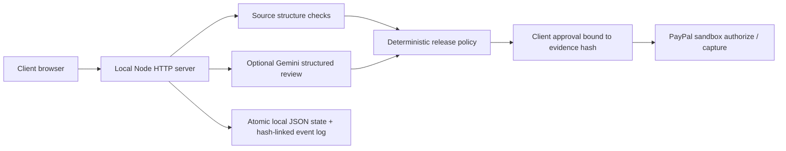

# TrustMesh — Proof before payment

Evidence-backed milestone reviews with client-approved PayPal sandbox authorization and capture. The working first slice shows incomplete work failing, corrected work passing, and a client releasing payment against the exact reviewed revision.

## Run locally

Requires Node.js 22.9+ (tested on Node 25.9). No dependencies or installation required.

```sh
cd trustmesh
npm start
```

Open http://localhost:3000. The server binds to loopback only. This is a single-user local prototype; do not expose it publicly without authentication and tenant isolation.

Default mode needs no credentials: payments are simulated and review uses local structural checks. **Offline mode does not call an AI model or PayPal.**

1. Click **Authorize demo payment**.
2. Load **Incomplete sample**, then **Review evidence**: password labeling and mobile layout fail. Release stays disabled.
3. Load **Corrected sample**, then review again: four source checks pass.
4. Review the findings, check the confirmation box, and **Simulate release**.
5. Export the JSON evidence/receipt. **Reset demo** starts again.

## Connect real sandbox and model APIs

Copy `.env.example` to `.env` and enter your own development credentials locally:

```dotenv
PAYMENT_MODE=sandbox
AI_MODE=gemini
PAYPAL_CLIENT_ID=your-sandbox-app-client-id
PAYPAL_CLIENT_SECRET=your-sandbox-app-secret
GEMINI_API_KEY=your-key
GEMINI_MODEL=gemini-2.5-flash
APP_URL=http://localhost:3000
PORT=3000
```

Restart the server. Create a PayPal developer sandbox app and a sandbox buyer account. The app's merchant account is the recipient; this prototype does not route payments to arbitrary contractors. Click **Authorize with PayPal**, approve as the sandbox buyer on PayPal, return, and click **Confirm PayPal approval**. The server authorizes only the order associated with its stored milestone. Then submit source for Gemini review and approve capture in the UI.

Model review transmits the submitted HTML and fixed criteria to Google's Gemini API. Use synthetic demo code. No source is executed. API credentials remain server-side. If the model or PayPal fails, the UI displays an error; it does not silently fall back to simulated success. You can configure payment and AI modes independently for development.

Sandbox mode has a separate persisted record and cannot use the demo reset route. Capture is limited to a conservative three-day window. Outside that window create a new workflow after resolving the old authorization; reauthorization and multi-project management are not implemented. A pending capture is labeled pending and requires manual provider verification; automated reconciliation is a next milestone.

## Architecture



| Provider operation | Endpoint |
|---|---|
| Get PayPal access token | `POST /v1/oauth2/token` |
| Create authorization order | `POST /v2/checkout/orders` |
| Authorize buyer-approved order | `POST /v2/checkout/orders/{id}/authorize` |
| Capture authorized amount | `POST /v2/payments/authorizations/{id}/capture` |
| Void uncaptured authorization | `POST /v2/payments/authorizations/{id}/void` |
| Structured evidence analysis | Gemini `POST /v1beta/models/{model}:generateContent` |

All payment requests use the sandbox host only. Amount and currency come from server state, never from browser input. Stable request IDs support provider retries, and completed local captures are idempotent. Only one mutation runs at a time in this single process.

## Validation

```sh
npm test
npm run check
```

Five tests cover missing evidence, malformed model output, evidence-hash changes, expired authorization, event integrity, and an HTTP journey with blocked release, failed review, revision, explicit approval, duplicate capture prevention, restart persistence, cancellation, and cross-origin rejection. Browser testing also exercised the incomplete → corrected → approval → simulated capture flow. External Gemini and PayPal transactions have **not** been verified without credentials.

## Current limits

- One fixed demo milestone, amount, client and contractor persona. No user identities, contract editor, or actual contractor payout.
- Structural source matching is a narrow heuristic, not DOM execution, accessibility certification, design validation, or robust adversarial code analysis. A model can be wrong; client review is mandatory.
- No GitHub/Figma import, untrusted code execution, multi-agent consensus, live thought stream, voice flow, or browser test runner is claimed.
- No webhook ingestion or pending-capture reconciliation yet. Only a completed capture response marks payment captured. No automatic payouts, vaulting, live-money mode, refund UI, or reauthorization.
- Local JSON persistence and process-level lock are suitable for one local demo instance. Production requires transactional storage, identity/authorization, CSRF/session controls, durable operation journals, provider reconciliation, rate limits, and expiration handling.
- Event hashes expose accidental changes but are not signed, externally anchored, or tamper-proof against someone who can rewrite the entire file.
- A process crash during an external request needs provider reconciliation; stable idempotency IDs are useful within the provider retention window, not an indefinite guarantee.

## Submission status

The initial runnable slice and tests are complete. Still required before claiming a competition-ready entry: successful Gemini and PayPal sandbox run, public licensed repository, final judge setup instructions, and a working demo video. Hosting is optional under the verified rules; local reproducibility is supported. See `docs/DECISION_REVIEW.md` and `docs/DEMO_SCRIPT.md`.

## License

MIT. See LICENSE.
